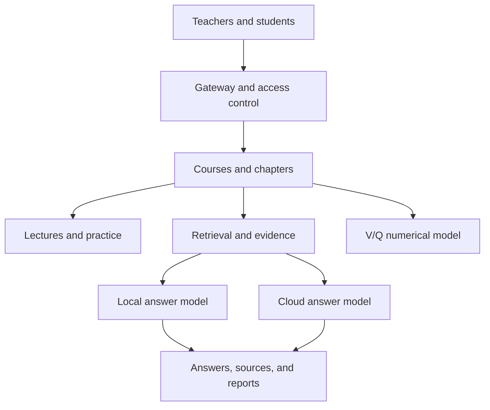

# Multi-Course Virtual Human Teaching Assistant (MC-VHTA)

A multi-course, multi-model teaching platform for physiology education. The
system connects PDF course preparation, material-grounded question answering,
virtual-human lectures, and chapter-based practice in one browser interface.
Respiratory physiology simulation provides an interactive subject-specific module
within the broader course platform.

Teachers upload PDF materials, review the extracted chapters, prepare lecture
scripts and practice questions, and share a course code with students. Students
can follow a lecture, ask questions grounded in the selected material, complete
practice, and explore the respiratory physiology model. Local and cloud answer
models are supported through separate execution paths.

Developed as a master's research project at the Graduate Institute of Physiology,
National Taiwan University.

**Research title:** Development and Technical Performance Evaluation of a Multi-Course, Multi-Model Virtual Human Teaching Assistant for Physiology Education.

The technical evaluation focuses on software behavior, answer accuracy, and
response time. Learning outcomes require a separate educational study.

[Hosted teaching system](https://multicourse-ta.twchu.workers.dev) (approved account required)
· [Setup guide](docs/getting-started.md)
· [Code guide](docs/code-map.md)
· [Evaluation guide](docs/evaluation.md)

This README and the application directory README are in English. Linked detailed
setup and research guides currently use Traditional Chinese.

---

## Table of Contents

- [Key Features](#key-features)
- [Requirements](#requirements)
- [Quick Start](#quick-start)
- [Installation](#installation)
- [Usage Guide](#usage-guide)
- [Command-Line Usage](#command-line-usage)
- [Configuration Reference](#configuration-reference)
- [Pipeline Architecture](#pipeline-architecture)
- [Testing and Evaluation](#testing-and-evaluation)
- [Troubleshooting](#troubleshooting)
- [Project Structure](#project-structure)
- [Methodology Notes](#methodology-notes)
- [Version and Citation](#version-and-citation)

---

## Key Features

- **Course preparation from PDFs** — upload material, review chapters, and prepare
  course-specific scripts, question banks, and retrieval indices.
- **Virtual-human lectures** — select a course and chapter, display the lecture
  script, and use the avatar and speech playback controls.
- **Student Q&A with evidence retrieval** — ask by text or voice and retrieve
  supporting passages before generating an answer.
- **Local and cloud answer models** — configure the installed local models and
  the deployment's cloud route; model tags must match the actual services.
- **Scenario practice and quiz navigation** — draw questions from the chapter
  bank, move between questions, retain selections, and review feedback.
- **Interactive V/Q simulation** — adjust ventilation, perfusion, and gas-exchange
  parameters and inspect the coupled numerical results.
- **Accounts, courses, and feedback** — administrator approval, teacher/student
  roles, course-code access, and answer reporting are part of the application.

The question-bank target is 100 questions per unit; the usable count depends on
source coverage and generation/review results. The respiratory simulator applies
to respiratory physiology. Uploading another subject's material does not
establish validated teaching performance for that subject.

---

## Requirements

| Component | Purpose |
|---|---|
| Git, Python 3.12, Node.js 22 or 24 | Clone the repository and run the offline checks. |
| Bash | Run operator scripts and the launcher regression suite on Linux; the suite is skipped without Bash or on non-POSIX systems. |
| PyMuPDF | Parse PDF course materials. |
| NumPy | Accelerate vector calculations; see [runtime requirements](requirements/runtime.txt). |
| Ollama and configured answer models | Run local answer generation. |
| BGE-M3 | Generate embeddings for retrieval. |
| Faster-Whisper, FFmpeg, and speech-model files | Run server-side speech recognition; see [speech requirements](requirements/speech.txt). |
| HTTPS, Cloudflare Worker/Tunnel, and a reachable backend | Provide the public entry point and complete browser login. |
| Administrator and mail-provider settings | Approve accounts and operate the configured email flows. |

The full-service launch scripts target a Linux server. Offline checks do not need
third-party Python packages, a GPU, private textbook content, or model/API keys.

### Hardware and private data

GPU/VRAM, RAM, model quantization, and concurrent users affect response time.
Minimum hardware requirements and cold-start time have not been measured on a
clean deployment; record the actual environment used for each experiment.

Textbook full text, private vector indices, model weights, uploaded course
materials, account databases, and credentials are not distributed here. A complete
installation needs the corresponding data and services in the operator's own
environment.

---

## Quick Start

Clone the project and run its offline checks first:

```bash
git clone https://github.com/Wayne59882/multi-course-virtual-human-ta.git
cd multi-course-virtual-human-ta
python3 scripts/check_offline.py
```

On Windows, replace `python3` with `py -3` if needed. The check command uses
fixtures and temporary local HTTP services. It does not start the complete
teaching service. Continue with Installation to prepare that environment.

---

## Installation

### 1. Prepare Python and deployment settings

Run these commands from the repository root in Linux/Bash:

```bash
python3 -m venv .venv
source .venv/bin/activate
python -m pip install -r requirements/runtime.txt
cp config/runtime.env.example .env
```

Edit `.env` with the actual paths, model tags, public URL, and administrator
email. Set `PYTHON_BIN` to the absolute path of the Python executable that can
import PyMuPDF, such as `.venv/bin/python` under the cloned repository.

> **The environment file is a template, not a complete installer.** Set `VQ_BASE`
> to the server's actual base directory and prepare the expected Ollama binary,
> model storage, and speech environment. The launchers do not load `.env`
> automatically; source it explicitly. See the [setup guide](docs/getting-started.md)
> for the required layout and the [operator script guide](scripts/README.md).

### 2. Prepare speech, materials, and models

The speech setup helper creates the expected Python environment if absent and
installs Faster-Whisper. FFmpeg and speech-model files still need to be available:

```bash
source .env
bash scripts/setup/prepare_stt.sh
```

The built-in Reference Textbook mode expects
`app/reference_corpus/chunks.jsonl`; the public repository contains metadata only.
Prepare passages from material you are entitled to use and configure the local
model services before preparing the index:

```bash
bash scripts/setup/prepare_reference.sh
"$PYTHON_BIN" app/reference_search.py --status
```

The reference helper checks or starts the embedding service, downloads BGE-M3
when necessary, and prepares the corpus index. Answer models need to be installed
separately with tags matching `.env`. The supplied model preparation helper also
downloads the legacy Granite model; review its downloads before using it.
Uploaded courses use their own workspaces and indices.

### 3. Start and check the services

```bash
source .env
bash scripts/start.sh
```

The launcher checks the model, speech, and retrieval services, starts the teaching
backends, and runs the gateway. It restarts matching backend processes on ports
8181/8182; account for running work when using it on an existing server.

In a second terminal, check the service endpoints:

```bash
curl --fail http://127.0.0.1:8179/api/health
curl --fail http://127.0.0.1:8181/api/health
curl --fail http://127.0.0.1:8182/api/reference/health
curl --fail http://127.0.0.1:11437/health
```

A successful health response means that endpoint responds. Verify retrieval,
model answers, microphone input, and login separately.

---

## Usage Guide

### 1. Open the system and sign in

Use the deployment's own HTTPS URL and an approved account. New accounts require
administrator approval. The complete login flow uses secure cookies; configure
the public URL, mail provider, and backend connectivity first. See the
[account guide](docs/releases/deployment/README_ACCOUNTS_R12_20261030.md).

### 2. Prepare a course as a teacher

Upload a PDF, confirm the course name and extracted chapters, and prepare the
lecture scripts, question bank, and retrieval index. Review the preparation
status and generated content before sharing the course code. Keep the source
materials, model settings, and review records with the evaluation run.

### 3. Join a course as a student

Select the built-in course or enter the teacher's code. Choose a chapter before
starting a lecture, asking a course question, or opening practice.

### 4. Use lectures and Student Q&A

Open the selected chapter's lecture and use its avatar and speech controls. Ask
a question by text or voice and review the returned answer and evidence. Report
an answer that needs review through the feedback interface.

### 5. Complete scenario practice

Draw questions from the prepared chapter bank, move between questions, and retain
answer selections. Finish the quiz to inspect feedback. Check the available bank
size if preparation produced fewer questions than the target.

### 6. Explore the V/Q model

For respiratory physiology, select a scenario or adjust ventilation, perfusion,
and gas-exchange parameters, then compare the calculated results. Numerical
checks include conservation constraints and reference cases.

The [demonstration guide](docs/demo-guide.md) lists a suggested presentation order
and the code and evaluation records that support it.

---

## Command-Line Usage

Run the main operator commands from the repository root:

```bash
# Run offline checks and optionally write a JSON report
python3 scripts/check_offline.py --report /tmp/mc-vhta-offline.json

# Check local web assets without network calls
python3 scripts/check_web_assets.py

# Start the complete service after configuring the environment
source .env
bash scripts/start.sh
```

Inspect the built-in corpus/index status or run the pilot dataset self-test:

```bash
python3 app/reference_search.py --status
python3 research/three_model_10q/benchmark_3models.py --self-test
```

The pilot self-test does not call real models or measure their performance.
Follow the [pilot instructions](research/three_model_10q/) before a live run,
which requires model endpoints and may call a cloud API. Setup, data preparation,
and deployment commands are indexed in [scripts/README.md](scripts/README.md).

---

## Configuration Reference

| Variable | Purpose / current default |
|---|---|
| `VQ_BASE` | Server environment base directory; set the actual path. |
| `PYTHON_BIN` | Python executable for the teaching services; must import PyMuPDF. |
| `OLLAMA_HOST` | Answer-model service; defaults to `127.0.0.1:11435`. |
| `VQ_REFERENCE_EMBED_HOST` | Embedding service; defaults to `127.0.0.1:11438`. |
| `VQ_REFERENCE_EMBED_MODEL` | Embedding model tag; defaults to `bge-m3:latest`. |
| `VQ_GEMMA_MODEL_TAG`, `VQ_MISTRAL_MODEL_TAG` | Local tags; must match models installed on the server. |
| `VQ_AUTH_ADMIN_EMAIL`, `VQ_FEEDBACK_TO_EMAIL` | Administrator and answer-report recipient settings. |
| `VQ_PUBLIC_URL` | The deployment's own public HTTPS URL. |

See [runtime.env.example](config/runtime.env.example). Names in settings are
configuration strings; record actual model IDs, quantization, hardware, and
software versions when reporting an evaluation.

---

## Pipeline Architecture



`app/gateway.py` handles entry and account/course access.
`app/reference_server.py` and `app/course_runtime.py` provide material services
and course preparation. `app/reference_search.py` handles built-in retrieval.
Shared frontend code is grouped by function under `app/web/shared/`.

BGE-M3 embeds passages already segmented by Python and embeds the student's
question. Built-in retrieval combines vector similarity, source balancing, and
semantic-window reranking. By default it assembles up to six evidence items,
subject to thresholds and the text budget. Text retrieval provides a fallback
when embedding or indexing fails.

See the [architecture guide](docs/architecture.md) for service paths and ports,
the [code guide](docs/code-map.md) for modules, and the
[development guide](docs/development.md) for directory responsibilities.

---

## Testing and Evaluation

### Offline functional checks

The check entry point covers V/Q numerical constraints, quiz navigation,
batch-response recovery, pronunciation text, manual recording stop,
question-generation fixtures, the 10-question pilot self-test, frontend
script order/content and local HTTP routes, and operator-script routing.
It also checks source syntax and maintained local documentation links.

GitHub Actions runs the same entry point with Python 3.12 and Node.js 22/24.
Launcher tests use stand-in commands in a temporary copy; they do not download
models, start the real backends, send mail, or deploy the website.

### Model evaluation

The [three-model, 10-question pilot](research/three_model_10q/) compares the same
questions using cached evidence and exports individual answers and a summary.
`expected_option` is used for scoring and is not inserted into the model prompt.
Live evaluation requires the private environment and model/API settings.

| Metric | Definition |
|---|---|
| Accuracy | Report correctness over all requests and over successfully completed requests separately. |
| Availability | Successfully completed requests divided by all requests. |
| Inference time | Time from the model request to completion of the response. |
| Question-to-reply time | Context retrieval time plus model response time; excludes browser rendering and TTS. |

See the [evaluation guide](docs/evaluation.md) for question sources, existing
results, seen/unseen distinctions, and scope. Passing offline checks does not
establish current model accuracy, latency, account isolation, production
reliability, or learning effectiveness.

---

The [performance guide](docs/performance.md) explains chapter pipelining, completed-step
recovery, CPU work budgets and measurements on the actual teaching server.

## Troubleshooting

| Symptom | What to check |
|---|---|
| A fresh clone cannot run the complete service | Prepare models, private materials, indices, speech dependencies, and administrator settings. |
| PDF parsing fails | Confirm that `PYTHON_BIN` can import `fitz`. |
| A model cannot be found | Compare installed model tags and service addresses with the configured values. |
| Retrieval returns no evidence | Check the selected material scope, index status, and fallback behavior. |
| The bank has fewer than 100 questions | Review source coverage and generation/review outcomes; 100 is the target. |
| An account cannot access a course | Check approval status, role, course code, HTTPS, and cookies. |
| Speech recognition does not start | Check Faster-Whisper, FFmpeg, model files, and port 11437. |
| An old tool appears to be missing | Check the [script index](scripts/README.md), `archive/`, and the [migration map](docs/migration-map.json). |
| The public URL returns 502 | Check the gateway, internal backends, Tunnel, and Worker origin separately. |

---

## Project Structure

| Location | Responsibility |
|---|---|
| [app/](app/) | Runtime Python services, course processing, accounts, retrieval, and web pages. |
| [app/web/shared/](app/web/shared/) | Shared JavaScript, CSS, avatars, images, and audio. |
| [scripts/setup/](scripts/setup/) | Model, embedding, speech, and TTS preparation. |
| [scripts/runtime/](scripts/runtime/) | Service startup and model/speech process helpers. |
| [scripts/deploy/](scripts/deploy/) | Cloudflare login, Tunnel, and Worker deployment tools. |
| [scripts/data/](scripts/data/) | Reference-material ingestion. |
| [config/](config/) | Public environment-setting examples. |
| [requirements/](requirements/) | Python runtime and optional speech package requirements. |
| [tests/](tests/) | Current regression checks, frontend migration contracts, and historical validators. |
| [research/](research/) | Model comparisons, questions, existing datasets, and V/Q validation records. |
| [docs/](docs/) | Architecture, setup, evaluation, demonstration, migration, and releases. |
| [archive/](archive/) | Historical deployment/install tools and inactive frontend code. |

The application lives in `app/`; operator tools live in `scripts/`. Historical
release files are separate from current runtime code. See the
[development guide](docs/development.md) for maintenance rules and the
[migration guide](docs/migration.md) for old-to-new paths and server migration.

---

## Methodology Notes

- **Material grounding:** retrieved evidence supports an answer but does not
  establish its correctness. Accuracy needs an independently scored evaluation.
- **Functional tests and model results:** fixtures check defined software
  behavior; live accuracy and response time require the specified dataset,
  endpoints, and environment.
- **Reproducibility:** package requirements are not a fully validated lockfile.
  Preserve resolved versions, hardware, models, source data, and Git commit.
- **Remaining implementation work:** shared frontend resources preserve their
  original loading order. Some global-function wrappers and large backend
  modules remain candidates for further refactoring.
- **Deployment:** source changes do not migrate or redeploy a teaching server.
  Transfer private data and settings and validate full workflows when updating
  the server; see the [migration guide](docs/migration.md).

---

## Version and Citation

The application is based on `v241.12.5-full-answer-voice`, including the R12
account and course-access updates. Source-layout changes are tracked through Git
commits; historical changes are listed in [CHANGELOG.md](CHANGELOG.md).

Author metadata and citation information are provided in
[CITATION.cff](CITATION.cff). Record the commit used when citing this research
software. This repository currently has no LICENSE file; code, teaching
materials, models, and third-party assets have separate licensing considerations.
